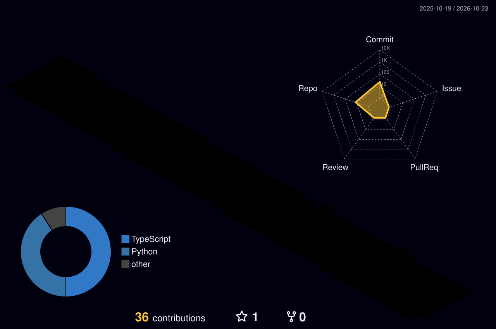

<div align="center">

  <!-- ==================== 3D FUTURISTIC CYBER HERO BANNER ==================== -->
  

  <!-- ==================== ANIMATED DYNAMIC TYPING ROLE ==================== -->
  <a href="https://rithishwaran.vercel.app/" target="_blank">
    
  </a>

  <!-- ==================== PRIMARY QUICK ACTION BADGES ==================== -->
  <p align="center">
    <a href="https://rithishwaran.vercel.app/" target="_blank">
      
    </a>
    &nbsp;
    <a href="https://www.linkedin.com/in/rithishwarank18/" target="_blank">
      
    </a>
    &nbsp;
    <a href="https://github.com/Rithishwaran1816" target="_blank">
      
    </a>
    &nbsp;
    <a href="https://github.com/zyphora-creations" target="_blank">
      
    </a>
  </p>

</div>

<p align="center">
  
</p>

### 🛰️ System Identity & Core Directive

<table width="100%">
<tr>
<td width="65%" valign="top">
<pre><code>architect: "Rithishwaran K"
leadership: "Founder @ Zyphora Creations"
disciplines:
  - "Agentic AI &amp; LLM Systems Engineering"
  - "Full-Stack Web &amp; Cross-Platform Mobile Development"
  - "Computer Vision &amp; Photogrammetric 3D Reconstruction"
  - "Cloud Architecture &amp; Scalable Microservices"
philosophy: "Turning cutting-edge AI breakthroughs into production-grade digital products."
status: "Active // Engineering intelligent client systems &amp; autonomous agent workflows"</code></pre>
<p>I am a software engineer, AI systems builder, and founder focused on turning complex technical concepts into intuitive, high-impact digital products. Through <b>Zyphora Creations</b>, I engineer client solutions spanning custom AI applications, intelligent chatbots, responsive web platforms, and mobile apps. My technical focus bridges <b>agentic AI architectures</b>, <b>real-time computer vision</b>, and <b>UAV-based spatial 3D reconstruction</b>.</p>
</td>
<td width="35%" align="center" valign="middle">

<br/>
<sub style="color:#00F0FF; font-family: monospace;"><b>// 3D NEURAL CORE ACTIVE //</b></sub>
</td>
</tr>
</table>

<p align="center">
  
</p>

### 🚀 Startup Spotlight: Zyphora Creations

<div align="center">
<table width="100%">
<tr>
<td width="70%" valign="top">
<h4>⚡ <a href="https://github.com/zyphora-creations">Zyphora Creations</a> — Digital Innovation Studio</h4>
<p>A modern creative technology studio engineering production software, smart automation, and bespoke digital experiences for forward-thinking businesses and clients.</p>
<ul>
<li>🤖 <b>AI Solutions &amp; Intelligent Chatbots:</b> Context-aware LLM agents and workflow automations.</li>
<li>🌐 <b>Full-Stack Web Systems:</b> High-performance React, Next.js, and API backends.</li>
<li>📱 <b>Cross-Platform Mobile Apps:</b> Fluid Flutter applications with clean architectures.</li>
<li>🎯 <b>Client Success:</b> Delivering tailored systems like the <i>Raghava School of Yoga</i> web platform.</li>
</ul>
</td>
<td width="30%" align="center" valign="middle">
<a href="https://github.com/zyphora-creations">

</a>
<br/><br/>

</td>
</tr>
</table>
</div>

---

### 🛠️ Technical Stack & Capabilities

<div align="center">
  
</div>

<br/>

| Capability Domain | Technologies & Infrastructure |
| :--- | :--- |
| **💻 Core Programming Languages** | <a href="https://skillicons.dev"></a> |
| **🧠 Artificial Intelligence, LLMs &amp; Agents** |   <br/>   |
| **👁️ Computer Vision &amp; 3D Spatial Computing** | <a href="https://skillicons.dev"></a><br/>   |
| **🌐 Full-Stack Web &amp; Backend Architecture** | <a href="https://skillicons.dev"></a> |
| **📱 Mobile Application Development** | <a href="https://skillicons.dev"></a> |
| **🗄️ Databases &amp; Cloud Infrastructure** | <a href="https://skillicons.dev"></a> |
| **🧰 Developer Tools &amp; Data Analytics** | <a href="https://skillicons.dev"></a><br/>    |

<p align="center">
  
</p>

<!-- ==================== 3D FULL SPATIAL BACKGROUND BANNER ==================== -->
<div align="center">
  
</div>

<br/>

### 📦 Project Showcase Matrix

| Project | Focus & Classification | Core Tech Stack | Links & Repository |
| :--- | :--- | :--- | :--- |
| 📍 **RouteIQ** | **Intelligent Route Optimization & Logistics**<br/>Algorithmic logistics system designing cost-efficient routing and dispatch intelligence. | `Python` `REST APIs` `Optimization` | [🔒 Private Prototype](https://github.com/Rithishwaran1816/RouteIQ) |
| 🌊 **AquaGuard** | **Smart IoT Water Monitoring Platform**<br/>Real-time telemetry dashboard and IoT telemetry pipeline for continuous water quality tracking. | `Kotlin` `React` `TypeScript` | [🌐 Live App](https://aquaguard-gamma.vercel.app) • [💻 Repo](https://github.com/Rithishwaran1816/Aquaguard) |
| 👁️ **Computer Vision Hub** | **Hand-Tracking Magic Portal & Gestures**<br/>Real-time interactive CV suite featuring 16 dynamic visual filters, pinch controls, and an open-palm invisibility cloak. | `Python` `OpenCV` `MediaPipe` | [💻 Repo](https://github.com/Rithishwaran1816/Computer-vision) |
| 💼 **Interactive Portfolio** | **Production Developer Portfolio**<br/>Futuristic personal showcase built with modern web standards, smooth navigation, and dark aesthetic. | `TypeScript` `React` `Tailwind CSS` | [🌐 Live Site](https://rithishwaran.vercel.app/) • [💻 Repo](https://github.com/Rithishwaran1816/portfolio) |
| 🧘 **Raghava School of Yoga** | **Client Platform (Zyphora Creations)**<br/>Responsive full-stack web platform built for a premier yoga institution with schedule and class discovery. | `React` `Full-Stack` `Vercel` | [💻 Org Repo](https://github.com/zyphora-creations/Raghava-school-of-yoga) |
| 🛸 **UAV 3D Reconstruction** | **Multi-Stage Spatial Photogrammetry**<br/>Research pipeline extracting point clouds and 3D geometric representations from aerial moving-UAV video footage. | `Python` `3D Point Clouds` `CV` | [💻 Repo](https://github.com/Rithishwaran1816/3d-rendering) |
| 🤖 **Agentic AI & Custom LLMs** | **Autonomous Tool-Calling Experiments**<br/>Exploration of multi-step task planning, agentic workflows, prompt routing, and domain-adapted LLM interfaces. | `LLMs` `Agents` `RAG` `Python` | [🔬 AI Research](https://github.com/Rithishwaran1816) |
| 🚀 **Zyphora Creations Hub** | **Digital Product & AI Venture**<br/>Official agency engineering enterprise digital transformations, web applications, and autonomous agents. | `Next.js` `Flutter` `AI Agents` | [🏢 Studio Org](https://github.com/zyphora-creations) |

<p align="center">
  
</p>

### 🧠 Current Directives & Engineering Focus

```
[PROGRESS MONITOR // ACTIVE LEARNING & BUILDING]
├── 01. Autonomous Agent Workflows   :: Designing multi-step task decomposition & tool execution
├── 02. LLM Context Optimization     :: Building robust RAG pipelines & localized inference
├── 03. Spatial 3D Reconstruction    :: Advancing photogrammetric pipelines for aerial UAV imagery
├── 04. Cloud Native Engineering     :: Architecting resilient microservices with Docker & cloud infra
└── 05. Client Solutions Scaling     :: Expanding Zyphora Creations into end-to-end digital ventures
```

---

### 🏙️ 3D Isometric Contribution Skyline

<div align="center">
  <p><i>Live dynamic 3D voxel representation of GitHub engineering contributions & repository commits:</i></p>
  
</div>

<p align="center">
  
</p>

### 📊 Telemetry & Live Developer Analytics

<div align="center">
<table width="100%">
<tr>
<td width="70%" align="center" valign="middle">
<a href="https://github.com/Rithishwaran1816">

</a>
<a href="https://github.com/Rithishwaran1816">

</a>
</td>
<td width="30%" align="center" valign="middle">

<br/>
<sub style="color:#00F0FF; font-family: monospace;"><b>// 3D TELEMETRY SYNC //</b></sub>
</td>
</tr>
</table>

  <br/>

  <!-- Contribution Streak -->
  <a href="https://github.com/Rithishwaran1816">
    
  </a>

  <br/><br/>

  <!-- Interactive Activity Graph -->
  <a href="https://github.com/Rithishwaran1816">
    
  </a>

</div>

---

### 🐍 Contribution Activity Matrix

<div align="center">
  <picture>
    <source media="(prefers-color-scheme: dark)" srcset="https://raw.githubusercontent.com/Rithishwaran1816/Rithishwaran1816/output/github-contribution-grid-snake-dark.svg">
    <source media="(prefers-color-scheme: light)" srcset="https://raw.githubusercontent.com/Rithishwaran1816/Rithishwaran1816/output/github-contribution-grid-snake.svg">
    
  </picture>
</div>

---

### 🌐 Transmit & Connect

<div align="center">

  <p>Let's collaborate on intelligent AI systems, high-performance web & mobile applications, or venture projects.</p>

  <a href="https://rithishwaran.vercel.app/" target="_blank">
    
  </a>
  &nbsp;
  <a href="https://www.linkedin.com/in/rithishwarank18/" target="_blank">
    
  </a>
  &nbsp;
  <a href="https://github.com/Rithishwaran1816" target="_blank">
    
  </a>
  &nbsp;
  <a href="https://github.com/zyphora-creations" target="_blank">
    
  </a>

  <br/><br/>

  <!-- Profile Visitor Counter -->
  

  <br/><br/>

  <!-- 3D Wave Footer -->
  

</div>
